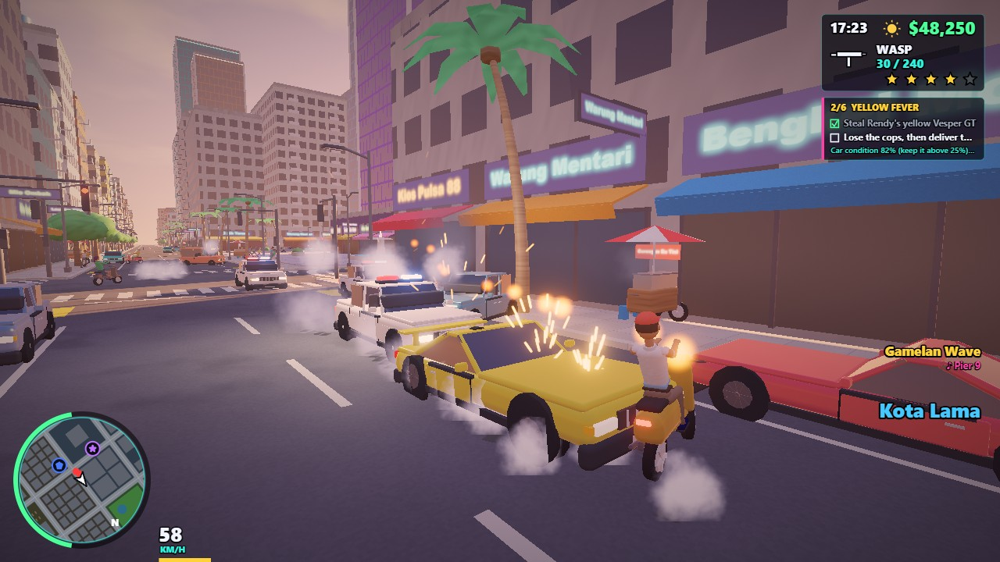
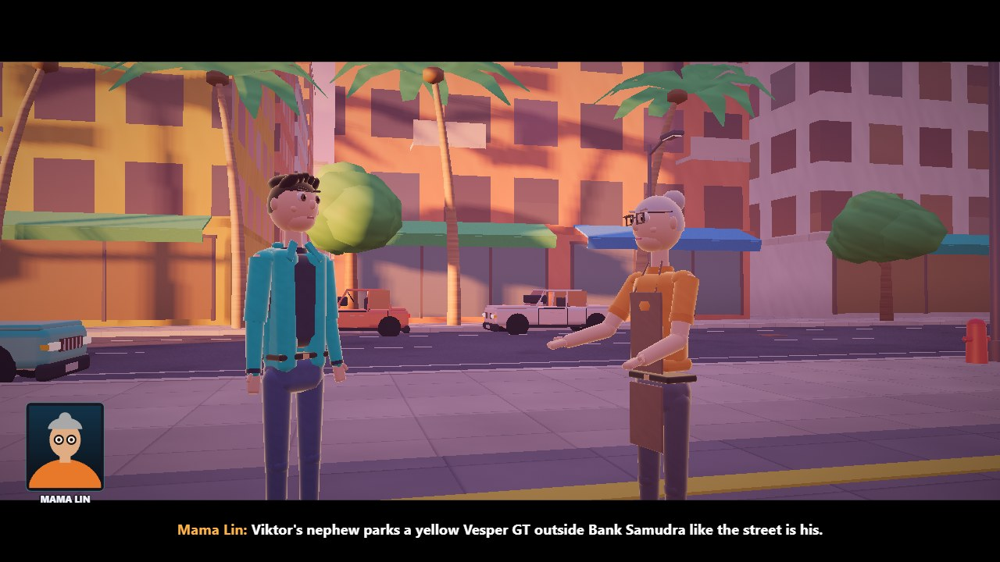
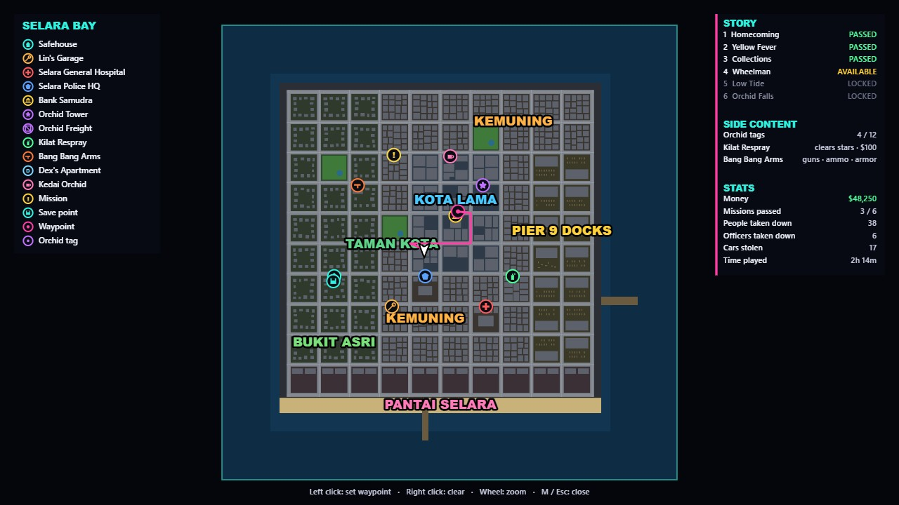
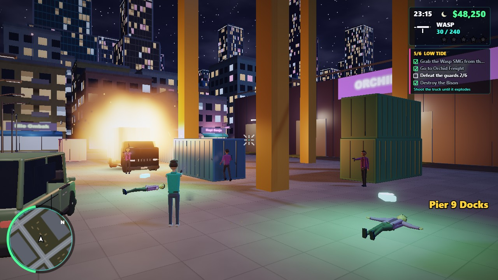

# SELARA BAY — Heat on the Coast

[](https://make.fun/bounty/gta6-01)
[](https://make.fun/bounty/gta6-01)
[](https://make.fun/bounty/gta6-01)

An original 3D open-world crime game for desktop Chrome, built for the make.fun bounty **gta6-01**.
Kai Santoso comes home to Selara Bay, a sun-soaked tropical coastal city, after five years away — and finds
Viktor Raza's Black Orchid syndicate squeezing the coast.

- **City:** a 10×10-block coastal city — Kota Lama towers, Kemuning shops, Bukit Asri houses, Pier 9 docks,
  Pantai Selara beach — with eleven landmarks, traffic lights, parks, piers and a day/night cycle.
- **Story:** six missions with in-engine cutscenes (Homecoming, Yellow Fever, Collections, Wheelman,
  Low Tide, Orchid Falls), plus 12 Orchid tags, Kilat Respray and Bang Bang Arms.
- **Systems:** traffic and pedestrians, car theft and carjacking, nine vehicle models (including Motor Bebek
  scooters with riders and Angkot Selara minibuses), a 5-star wanted level with line-of-sight tracking,
  pursuits, officers on foot, roadblocks and the Rajawali helicopter; four weapons, gang cover AI,
  explosions; HUD with a mission tracker, rotating minimap and GPS, a map & dossier screen, save games.
- **Street life:** readable shop and blade signs (Es Cendol, Kopi Senja, Bengkel Motor, Mie Ombak, Bakso
  Lestari, Laundry Kilau…) and warung carts with striped umbrellas on the sidewalks.
- **Soundtrack:** three radio stations and a score, all synthesized live (see [MUSIC.md](MUSIC.md)).

## Screenshots






## Run it

```sh
node serve.ts          # serves game/ on http://localhost:8080
```

Open http://localhost:8080 in desktop Chrome. No build step, no network requests.

## Controls

WASD move/drive · mouse look (click to lock) · Shift sprint · Space jump/handbrake · right mouse aim ·
left mouse shoot/punch/drive-by · Q/E or wheel switch weapon · R reload · F enter/exit/steal car · H horn ·
M map · Esc pause · F3 FPS counter.

## Engine

A custom WebGL2 renderer written from scratch for this game — no Three.js, no libraries:
one lit shader with procedural materials (facade windows that glow at night, asphalt grime and puddles,
clearcoat paint, glass fresnel), rigged meshes with up to 16 bones for characters and cars, a camera-fitted
PCF shadow map, a time-of-day sky with stars and moon, forward point/spot lights, an animated water surface,
HDR bloom, auto exposure and ACES tone mapping. All geometry is procedural; signs are rendered into a canvas
atlas. Quality presets (Low / Medium / High) scale shadows, bloom, lights, render scale and draw distance;
the first run picks one from a short FPS probe, and adaptive resolution keeps Low/Medium smooth.

Measured in headed desktop Chrome at 1280×720 on a modest GPU: **Low 37 fps · Medium 32 fps · High 29 fps**.

## Soundtrack

All audio is synthesized live with Web Audio. See [MUSIC.md](MUSIC.md).

## Testing

`npm i && node tools/playtest.mjs` plays the game in headed Chrome with real keyboard and mouse input
(walking, two real drives along the road graph, a real aimed firefight, losing the wanted level, all six
missions, save/continue, death, arrest, map, pause, respray, gun shop).

## License

MIT — see [LICENSE](LICENSE).
