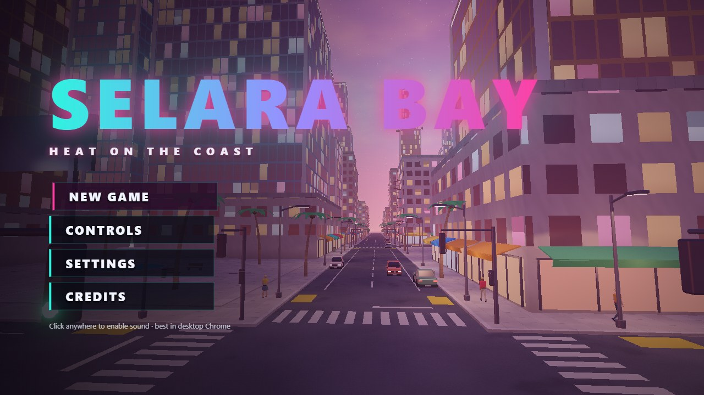
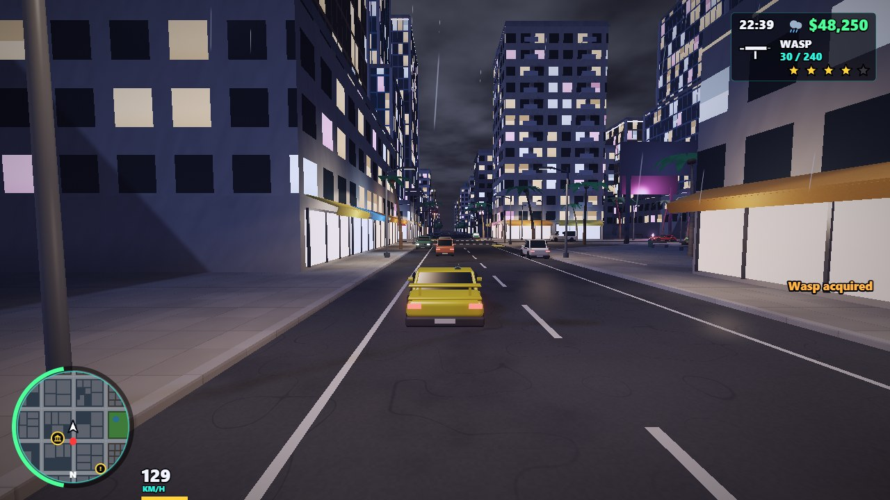
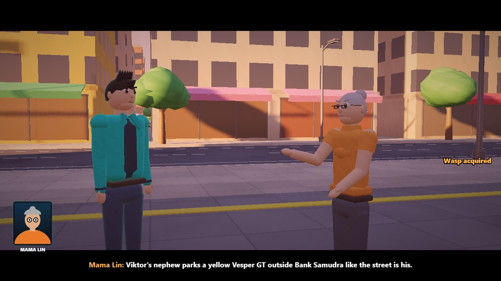

# SELARA BAY — Heat on the Coast

[](https://make.fun/bounty/gta6-01)
[](https://make.fun/bounty/gta6-01)
[](https://make.fun/bounty/gta6-01)

An original 3D open-world crime game for desktop Chrome, built for the make.fun bounty **gta6-01**.
Kai Santoso comes home to Selara Bay, a sun-soaked tropical coastal city, after five years away — and finds
Viktor Raza's Black Orchid syndicate squeezing the coast. Six story missions, a 10×10-block city with five
districts, traffic, pedestrians, police with a 5-star wanted level, car theft, gunfights, a minimap, save games
and a fully synthesized soundtrack and sound effects.

## Screenshots






## Run it

```sh
node serve.ts          # serves game/ on http://localhost:8080
```

Open http://localhost:8080 in desktop Chrome. No build step, no network requests.

## Controls

WASD move/drive · mouse look (click to lock) · Shift sprint · Space jump/handbrake · right mouse aim ·
left mouse shoot/punch/drive-by · Q/E or wheel switch weapon · R reload · F enter/exit/steal car · H horn ·
M map · Esc pause · F3 FPS counter.

## Engine

A custom WebGL2 renderer written from scratch for this game — no Three.js, no libraries:
one lit shader with procedural materials (facade windows that glow at night, asphalt grime and puddles,
clearcoat paint, glass fresnel), rigged meshes with up to 16 bones for characters and cars, a camera-fitted
PCF shadow map, a time-of-day sky with stars and moon, forward point/spot lights, an animated water surface,
HDR bloom, auto exposure and ACES tone mapping. All geometry is procedural; signs are rendered into a canvas
atlas. Quality presets (Low / Medium / High) scale shadows, bloom, lights, render scale and draw distance.

## Soundtrack

All audio is synthesized live with Web Audio. See [MUSIC.md](MUSIC.md).

## Testing

`npm i && node tools/playtest.mjs` plays the game in headed Chrome with real keyboard and mouse input
(walking, two real drives along the road graph, a real aimed firefight, losing the wanted level, all six
missions, save/continue, death, arrest, map, pause, respray, gun shop).

## License

MIT — see [LICENSE](LICENSE).
